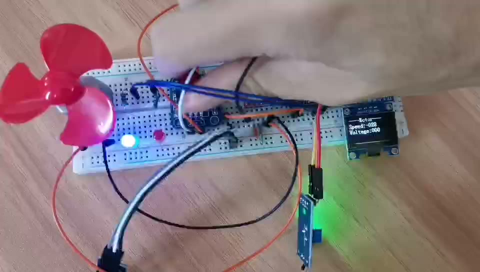

<div align="center">

# 智能降温风扇

**STM32F103C8T6 · 温度自动调速 + 旋钮手动调速 + 超温声光报警**

温度高了自动吹，想手动就拧旋钮，过热亮红灯报警。



</div>

---

## 这是什么

一块面包板就能搭出来的小东西：一个 NTC 温度传感器盯着环境温度，一个 3 叶小风扇负责降温，一个旋钮随时接管转速，OLED 实时显示温度、速度和当前模式。

逻辑不复杂，但把 STM32 的**五个常用外设**都串了一遍：

| 外设 | 用途 | 用到的知识点 |
|---|---|---|
| ADC1 | 读温度传感器模拟电压 | 单次转换、软件触发、8 次平均、线性标定 |
| TIM2 通道 3 | 输出 PWM 控制电机速度 | 时基、CCR 占空比、100 级调速 |
| EXTI0 / EXTI1 | 读取旋转编码器 | 外部中断、两相正交判向 |
| TIM3 更新中断 | 蜂鸣器 500 Hz 方波 | 定时中断、GPIO 翻转 |
| GPIO 软件 I²C | 驱动 0.96″ OLED | 软时序、显存刷新 |

## 硬件清单

| 器件 | 说明 |
|---|---|
| STM32F103C8T6 最小系统板 | "蓝板"，72 MHz，64 KB Flash / 20 KB RAM |
| 0.96″ OLED（SSD1306） | 4 针 I²C，128×64 |
| 旋转编码器（EC11） | 带按压，本项目只用了旋转 |
| 直流电机 + 塑料扇叶 | 3~5 V 小电机 |
| 电机驱动模块 | L298N / TB6612 均可，代码只用「方向 2 根 + PWM 1 根」 |
| NTC 温度传感器模块 | 模拟输出 AO，探头测温 |
| 有源/无源蜂鸣器 | 由定时器方波驱动 |
| 红、绿 LED 各一 | 低电平点亮 |

## 接线

| 引脚 | 功能 | 接到 |
|---|---|---|
| PA0 | ADC1_IN0 | 温度传感器 AO |
| PA2 | TIM2_CH3（PWM） | 电机驱动 ENA / PWMA |
| PA4 / PA5 | GPIO 推挽 | 电机驱动 IN1 / IN2（方向） |
| PA8 / PA9 | GPIO 推挽 | 红灯 / 绿灯（**低电平点亮**） |
| PB0 / PB1 | EXTI0 / EXTI1 | 旋转编码器 A 相 / B 相 |
| PB8 / PB9 | GPIO 开漏 | OLED SCL / SDA |
| PB12 | GPIO 推挽 | 蜂鸣器（由 TIM3 中断翻转） |

> 电机和主控**必须共地**；电机电源单独供，不要从 3.3 V 取电。

## 控制逻辑

主循环每圈读一次温度，按温度分三档：

| 温度 T | 模式 | OLED 显示 | 行为 |
|---|---|---|---|
| T > 25 ℃ | 自动 | `AUTO` / `ALARM` | 速度 = 温度，温度越高转得越快 |
| 20 ~ 25 ℃ | 死区 | `IDLE` | 电机停转（防止临界点来回跳） |
| T < 20 ℃ | 手动 | `MANU` | 旋钮每格 ±4，可正反转 |

自动档里还有报警子状态，**带 10 ℃ 迟滞**：

- **55 ~ 65 ℃**：红灯绿灯全灭，预警但不响
- **> 65 ℃**：红灯亮 + 蜂鸣器响，**回落到 55 ℃ 才解除**，避免在阈值上"滴滴"抖

温度换算就是一条直线，且做了限幅：

```c
int16_t AD_GetTemperature(void)   // AD.c
{
    /* 连采 8 次取平均，抑止末位跳动 */
    Average = (int32_t)(Sum / 8);                    // 先转有符号，防止无符号相减溢出
    Temp    = (int16_t)(100 - (Average - 1730) / 2.1f);   // ADC 1730~1940 → 100~0 ℃
    if (Temp < 0)   Temp = 0;                        // 传感器没接时不显示天文数字
    if (Temp > 100) Temp = 100;
    return Temp;
}
```

## 程序结构

```
├─ Start/      启动文件、stm32f10x.h、system_stm32f10x.c（ST 官方）
├─ Library/    STM32F10x 标准外设库（ST 官方，当黑盒用）
├─ System/     Delay.c —— SysTick 实现的 us/ms/s 延时
├─ Hardware/   自己的驱动：AD / Motor / PWM / Encoder / LED / OLED / Timer
├─ User/       main.c（业务逻辑全在这）、stm32f10x_it.c、stm32f10x_conf.h
├─ Project.uvprojx   Keil MDK 工程
└─ docs/       项目流程说明.html（图文详解，建议先看这个）
```

想读懂代码，按这个顺序看：**`main.c` → `Motor.c` + `PWM.c` → `AD.c` → `Encoder.c` → `Timer.c`**，半小时能通。

## 编译与下载

1. 装 **Keil MDK 5** + `Keil.STM32F1xx_DFP`（本工程用的是 2.4.1）
2. 双击 `Project.uvprojx` 打开
3. `F7` 编译，`F8` 下载（ST-Link / DAP-Link / J-Link 都行，在 `Options → Debug` 里选）
4. 复位运行

命令行也可以：

```bash
UV4.exe -b Project.uvprojx      # 编译
```

> 默认没开 `Create HEX File`，产物是 `Objects/Project.axf`，可以直接用 ST-Link Utility / STM32CubeProgrammer 烧。需要 `.hex` 就在 `Options → Output` 里勾上。

本版用 ARM Compiler 6（armclang）实测：**0 Error / 0 Warning**，Code 6946 B + RO 1774 B + ZI 1648 B，占用 Flash 8.5 KB、RAM 1.6 KB。

## v2 改了什么

原版代码能跑，但有几处"当时这么写能过、回头看必须改"的硬伤。v2 逐条修掉，改动都写在注释里：

| # | 原版问题 | v2 做法 |
|---|---|---|
| 1 | TIM2 被 `PWM_Init()`（ARR=99）和 `Timer_Init()`（ARR=9）配置两次，PWM 只剩 10 个速度等级 | 蜂鸣器整体搬到 **TIM3**，TIM2 只归 PWM |
| 2 | 报警时 `TIM_SetAutoreload(TIM2, 190)` 改的是 PWM 周期且永不还原，报过一次警电机永久变弱 | 不再改 ARR，音调固定 500 Hz，报警只切 `Buzzer_Set()` |
| 3 | `PB1` 一脚两用：既是编码器 B 相又被 `Key_GetNum()` 当按键读，转旋钮时主循环被 20 ms 延时甚至死等卡住 | **删除 Key 模块**，PB1 只属于编码器 |
| 4 | `LED.c` 是死代码（`LED_Init()` 从未调用），且 `PA2` 与 PWM 冲突 | LED 重写为 PA8/PA9，`LED_Init()` 真正被调用，`motor.c` 不再碰灯 |
| 5 | 蜂鸣器脚 PB12 从没初始化过，能响纯靠 `OLED.c` 里 `GPIO_Pin_8\|GPIO_Pin_12` 的笔误 | PB12 由 Timer 模块初始化，`OLED.c` 改正为 `GPIO_Pin_8` |
| 6 | `Voltage` 变量名其实是温度，无限幅，负温度显示成天文数字 | 改名 `Temperature`，新增 `AD_GetTemperature()` 做 8 次平均 + 限幅 0~100 |
| 7 | `Speed` 用 `int8_t` 表达 −99~99 可能溢出；`if (Speed>=100) Speed=0` 是清零不是限幅 | 全面改 `int16_t`，越界只夹到 ±99，`PWM_SetCompare3()` 内再加一道兜底 |
| 8 | 三个模式写成三个独立 `if`，阈值散落在代码里 | 改为 `if / else if / else` + 顶部宏定义阈值，新增 `WorkMode` 状态变量 |

> 第一版（tag `v1`）的原始代码原样保留在 git 历史里，`docs/项目流程说明.html` 逐行分析的正是那一版——想看"坑是怎么挖出来的"，`git checkout v1`。

## 文档

| 文件 | 内容 |
|---|---|
| [docs/项目流程说明.html](docs/项目流程说明.html) | 系统框图、主循环流程图、状态机、引脚表、逐行代码对照、8 个坑、修改顺序 |

> 该文档基于 **v1 原始代码**（含行号），v2 已修复其中全部 8 个问题，行号可能与当前代码有偏移。

<div align="center">


*OLED 四行：标题 / Speed / Temp / Mode*

</div>
